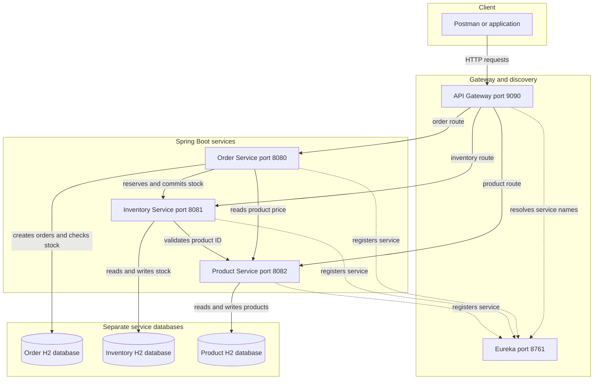
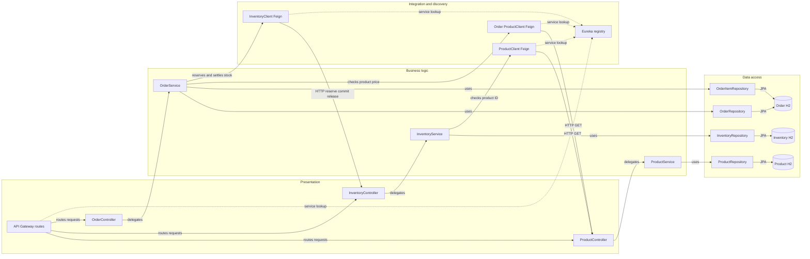

# Architecture Diagram

This document explains how the e-commerce services are connected and follows requests from the client through the gateway and service layers to storage.

## Application Architecture

<!-- mermaid-checked: no \n, no em-dash/en-dash, no {} in labels, subgraphs are id["label"], arrows are -->|"label"|, all subgraphs closed by end, ids unique -->


### Technology Stack Summary

| Layer | Technology | Version | Purpose |
|---|---|---:|---|
| Language | Java | 21 | Service implementation |
| Application framework | Spring Boot | 4.2.0 | Service runtime and dependency injection |
| Service discovery | Spring Cloud Netflix Eureka | 2026.0.0 BOM | Service registration and lookup |
| Edge routing | Spring Cloud Gateway WebFlux | 2026.0.0 BOM | Client-facing routes and path rewriting |
| Service-to-service HTTP | OpenFeign | Spring Cloud managed | Calls between order, inventory, and product services |
| Persistence | Spring Data JPA and Hibernate | Spring Boot managed | Repository-based data access |
| Local database | H2 | Spring Boot managed | Separate in-memory database for each service |
| Observability | Spring Boot OpenTelemetry starter | Spring Boot managed | Trace instrumentation configured in services |

### Data Storage & External Services

Product Service owns product details in its `productdb`; Inventory Service owns quantities in `inventorydb`; and Order Service stores orders and order items in `orderdb`. These are separate in-memory H2 databases, so data is local to each service process and does not survive a restart. Inventory and order items refer to products and orders by ID rather than cross-service database foreign keys. There is no message broker in the current request path. Eureka supplies service discovery for gateway routing and Feign calls.

### Key Architectural Decisions

- Each service owns its data. Cross-service links use IDs and HTTP APIs, not JPA relationships across databases.
- The gateway exposes client routes, while Eureka and load-balanced service names help services locate one another.
- Orders store a price snapshot from Product Service and reserve inventory through Inventory Service APIs. Completing an order consumes the reservation; failing it releases the reservation.

## Component Relationships

<!-- mermaid-checked: no \n, no em-dash/en-dash, no {} in labels, subgraphs are id["label"], arrows are -->|"label"|, all subgraphs closed by end, ids unique -->


### Component Inventory

| Component | Layer | Type | Responsibility |
|---|---|---|---|
| API Gateway | Edge | Spring Cloud Gateway | Routes `/api/v1/orders` plus `/product` and `/inventory` aliases |
| Eureka Server | Infrastructure | Service registry | Tracks service instances for discovery |
| ProductController | Product Service | REST controller | Exposes product create, read, update, and delete endpoints |
| ProductService | Product Service | Business service | Applies product operations and delegates persistence |
| ProductRepository | Product Service | Spring Data repository | Reads and writes products |
| InventoryController | Inventory Service | REST controller | Exposes stock lookup, creation, update, and deletion endpoints |
| InventoryService | Inventory Service | Business service | Validates quantities, verifies product IDs, and updates stock |
| InventoryRepository | Inventory Service | Spring Data repository | Reads and writes inventory by product ID |
| ProductClient | Inventory Service | Feign client | Looks up product details by ID |
| OrderController | Order Service | REST controller | Creates, reads, and updates order status; accepts order items |
| OrderService | Order Service | Business service | Calculates totals, records items, and coordinates inventory reservations |
| InventoryClient | Order Service | Feign client | Reserves, commits, or releases inventory |
| ProductClient | Order Service | Feign client | Reads trusted product price for the order item |
| OrderRepository | Order Service | Spring Data repository | Reads and writes orders |
| OrderItemRepository | Order Service | Spring Data repository | Reads and writes order items |

## Request Walkthrough

### 1. Create a product

```text
Client
  -> POST http://localhost:9090/product
  -> API Gateway matches /product and rewrites it to /api/products
  -> ProductController
  -> ProductService
  -> ProductRepository
  -> productdb
  <- saved product, including productId
  <- API Gateway
  <- Client
```

The client must keep the returned `productId`; inventory and order requests use that ID.

### 2. Add inventory for that product

```text
Client
  -> POST http://localhost:9090/inventory
  -> API Gateway rewrites it to /api/inventory
  -> InventoryController
  -> InventoryService validates quantities and checks for duplicate inventory
  -> ProductClient uses Eureka to find Product Service
  -> GET /api/products/:productId
  <- Product Service confirms the product exists
  -> InventoryRepository saves the productId and quantities to inventorydb
  <- Inventory response
  <- API Gateway
  <- Client
```

The request body contains `productId`, `stockQuantity`, and `reservedQuantity`. Product Service remains the source of product details; Inventory Service only stores the product ID and stock data.

### 3. Place an order

Create an empty pending order:

```http
POST http://localhost:9090/api/v1/orders
```

No request body is required. The response includes the generated order `id`.

```text
Client
  -> POST /api/v1/orders
  -> API Gateway routes to Order Service
  -> OrderController asks OrderService to create a pending order
  -> OrderRepository saves it to orderdb
  <- order id, PENDING status, and zero total
```

Add an item:

```text
Client
  -> POST /api/v1/orders/:orderId/items with productId and quantity
  -> Order Service confirms the order is PENDING
  -> ProductClient gets the current price from Product Service
  -> OrderItemRepository saves the item and server-selected price
  -> InventoryClient asks Inventory Service to reserve the quantity
  -> Inventory Service checks available stock and updates inventorydb
  -> Order Service recalculates and saves the order total
  <- saved order item
```

Check an order with `GET /api/v1/orders/:orderId`. Complete it with `PATCH /api/v1/orders/:orderId/status?newStatus=COMPLETED`; Inventory Service consumes reserved stock by lowering both stock and reserved quantity. Failing it with `newStatus=FAILED` releases the reserved quantity without consuming stock.

The older quick-purchase endpoint `POST /api/v1/orders/place/:productId` still reserves and immediately commits one unit without creating an order record. Prefer the create-order/add-item flow when you need an order saved in orderdb.

Inventory changes happen in a different service/database from order writes. Each inventory operation is atomic and uses optimistic locking to reject concurrent conflicting updates, but this is not a distributed transaction: if a service fails between reservation and order persistence or settlement, a production system needs a saga/compensation workflow to reconcile the states.
